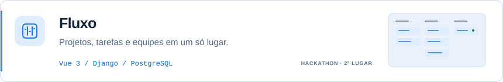
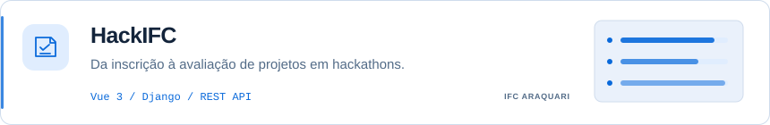
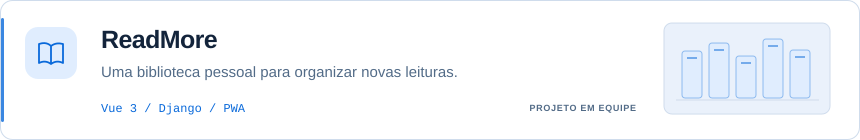

<picture>
  <source media="(max-width: 600px) and (prefers-color-scheme: dark)" srcset="assets/dev-header-mobile-dark.svg">
  <source media="(max-width: 600px)" srcset="assets/dev-header-mobile-light.svg">
  <source media="(prefers-color-scheme: dark)" srcset="assets/dev-header-dark.svg">
  
</picture>

  <a href="https://renandelimadev.class.fabricadesoftware.ifc.edu.br"><strong>Portfólio ↗</strong></a>
  &nbsp; · &nbsp;
  <a href="https://www.linkedin.com/in/renan-de-lima-3876532b8/">LinkedIn</a>
  &nbsp; · &nbsp;
  <a href="mailto:rennlima477@gmail.com">E-mail</a>

### Sobre mim

Sou estudante de **Informática para Internet no IFC Araquari** e bolsista da **Fábrica de Software**. Desenvolvo aplicações web com **Vue e Django**, do front-end à API.

Por aqui você encontra projetos que construo com outras pessoas, ideias que tiro do papel e o que vou aprendendo no caminho.

### Tecnologias

<picture>
  <source media="(prefers-color-scheme: dark)" srcset="https://skillicons.dev/icons?i=vue,js,tailwind,python,django,postgres,git,github&amp;theme=dark">
  
</picture>

### Projetos

<a href="https://github.com/DreamTeam-2k26/frontend">
<picture>
  <source media="(max-width: 600px) and (prefers-color-scheme: dark)" srcset="assets/project-fluxo-mobile-dark.svg">
  <source media="(max-width: 600px)" srcset="assets/project-fluxo-mobile-light.svg">
  <source media="(prefers-color-scheme: dark)" srcset="assets/project-fluxo-dark.svg">
  
</picture>
</a>

<a href="https://github.com/fabricadesoftware-ifc/fabricaHackathon_frontEnd">
<picture>
  <source media="(max-width: 600px) and (prefers-color-scheme: dark)" srcset="assets/project-hackifc-mobile-dark.svg">
  <source media="(max-width: 600px)" srcset="assets/project-hackifc-mobile-light.svg">
  <source media="(prefers-color-scheme: dark)" srcset="assets/project-hackifc-dark.svg">
  
</picture>
</a>

<a href="https://github.com/ReadMore-Org">
<picture>
  <source media="(max-width: 600px) and (prefers-color-scheme: dark)" srcset="assets/project-readmore-mobile-dark.svg">
  <source media="(max-width: 600px)" srcset="assets/project-readmore-mobile-light.svg">
  <source media="(prefers-color-scheme: dark)" srcset="assets/project-readmore-dark.svg">
  
</picture>
</a>

<strong>Estatísticas do GitHub</strong>

 
<picture>
  <source media="(prefers-color-scheme: dark)" srcset="https://github-profile-summary-cards.vercel.app/api/cards/profile-details?username=renan1811&amp;theme=github_dark">
  
</picture>

---

Entre um commit e outro, sempre aprendendo.

