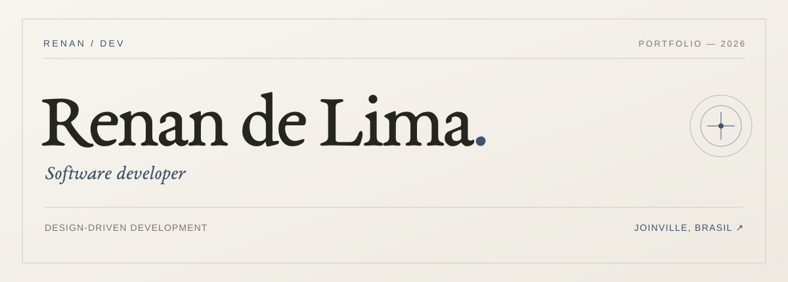
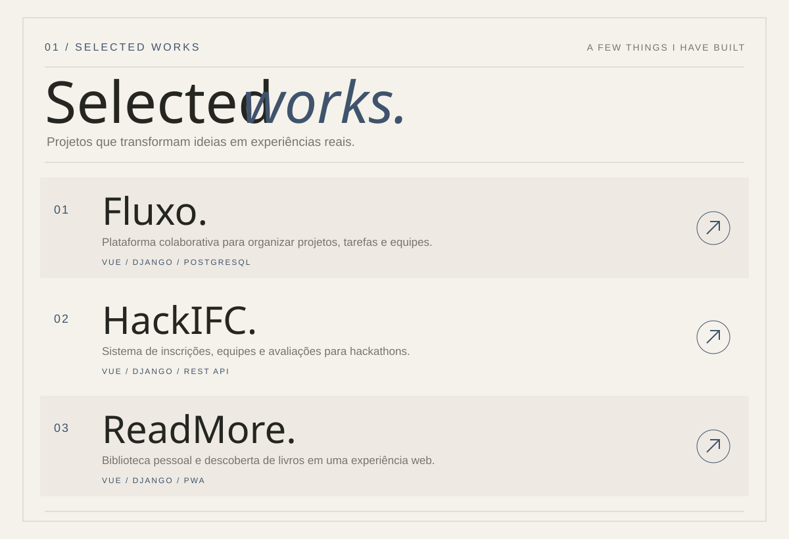
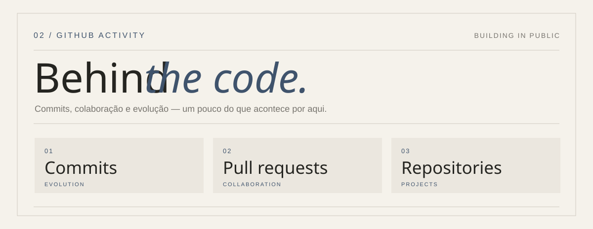

  

  <a href="https://renandelimadev.class.fabricadesoftware.ifc.edu.br">Portfolio</a>
  &nbsp; · &nbsp;
  <a href="https://www.linkedin.com/in/renan-de-lima-3876532b8/">LinkedIn</a>
  &nbsp; · &nbsp;
  <a href="mailto:rennlima477@gmail.com">Contato</a>

 

  

  <a href="https://github.com/DreamTeam-2k26/frontend">Fluxo ↗</a>
  &nbsp; · &nbsp;
  <a href="https://renandelimadev.class.fabricadesoftware.ifc.edu.br">HackIFC e ReadMore no portfólio ↗</a>

 

  

  
  

  

