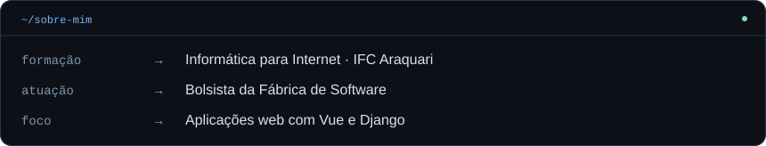
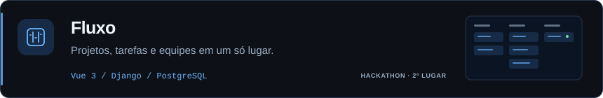
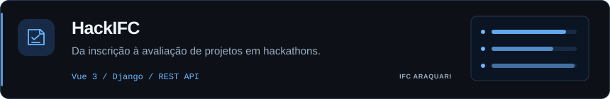
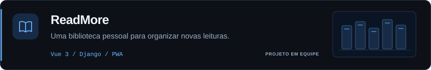

<a href="https://github.com/renan1811">
<picture>
  <source media="(max-width: 600px)" srcset="assets/dev-header-mobile-dark.svg">
  
</picture>
</a>

  <a href="https://renandelimadev.class.fabricadesoftware.ifc.edu.br"><strong>Portfólio ↗</strong></a>
  &nbsp; · &nbsp;
  <a href="https://www.linkedin.com/in/renan-de-lima-3876532b8/">LinkedIn</a>
  &nbsp; · &nbsp;
  <a href="mailto:rennlima477@gmail.com">E-mail</a>

 

<picture>
  <source media="(max-width: 600px)" srcset="assets/about-mobile-dark.svg">
  
</picture>

### Tecnologias

### Projetos

<a href="https://github.com/DreamTeam-2k26/frontend">
<picture>
  <source media="(max-width: 600px)" srcset="assets/project-fluxo-mobile-dark.svg">
  
</picture>
</a>

<a href="https://github.com/fabricadesoftware-ifc/fabricaHackathon_frontEnd">
<picture>
  <source media="(max-width: 600px)" srcset="assets/project-hackifc-mobile-dark.svg">
  
</picture>
</a>

<a href="https://github.com/ReadMore-Org">
<picture>
  <source media="(max-width: 600px)" srcset="assets/project-readmore-mobile-dark.svg">
  
</picture>
</a>

### No GitHub

  
  

---

Entre um commit e outro, sempre aprendendo.

